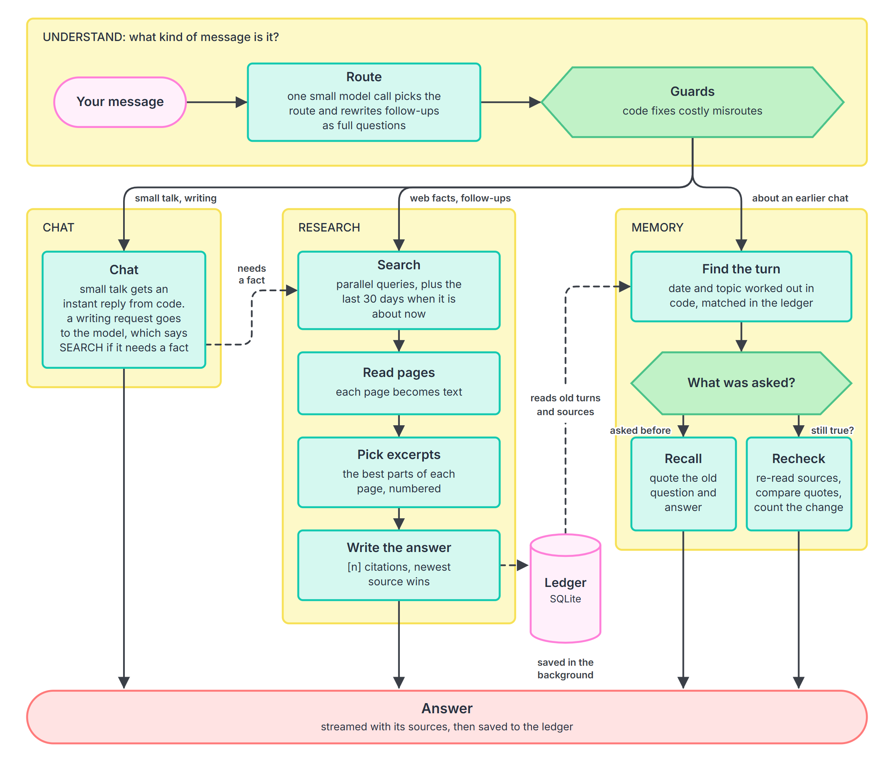

# tracebac

A chat agent whose only tool is web search. It answers with cited sources, remembers what you asked and when, and can check whether its own earlier answers still hold ("has any of that changed since Monday?"). The thinking behind it is in [DESIGN.md](DESIGN.md).

## Run it

You need Node 22.18 or newer and two free API keys. None of them needs a credit card. One key is for a model and one is for search.

```bash
npm install
cp .env.example .env
```

On Windows, use `copy .env.example .env` instead. Then open `.env` and add at least one key from each group.

Model keys, pick one or more:

* Cerebras: https://cloud.cerebras.ai
* Groq: https://console.groq.com/keys
* Gemini: https://aistudio.google.com/apikey
* OpenRouter: https://openrouter.ai/keys

Search keys, pick one or more:

* Tavily: https://app.tavily.com
* Exa: https://dashboard.exa.ai
* Serper: https://serper.dev

Cerebras plus Tavily is the easiest start. More keys means more fallbacks, which helps a lot on free tiers. If a key is missing, the app stops and tells you which one and where to get it.

```bash
npm run dev
```

Now open http://localhost:3000. Your chats are saved in `data/tracebac.db`. Delete the `data` folder whenever you want a clean start.

## Try it

A few things to ask:

* `compare neon and supabase pricing for postgres`
* `last fc barcelona game with score`, then `games before that?`
* `give me funny pickup lines`, then `give me 5 more`

### Questions about earlier days

A fresh install has no history, so a question like "what did I ask on Monday?" has nothing to find. The replay script fixes that. It asks a few real questions as if you had asked them earlier this week, with real searches and real answers.

1. Set `ALLOW_CLOCK_OVERRIDE=true` in `.env` and restart `npm run dev`.
2. In a second terminal, run `npm run replay`. It takes about a minute.
3. Open http://localhost:3000/?user=demo and ask the questions it prints. For example:

   * `On Monday we shortlisted 5 CRM tools for a 20 person sales team. Has any of them changed pricing or shipped something big since?`
   * `What did I ask you on 10 November? Is your answer still correct today?`
   * `Last Tuesday I asked you about Postgres hosting. Has any pricing changed since then?`

## How it works



* **Route.** One small model call decides what kind of message you sent. It also turns a question that builds on the last one into a full question, so "games before that?" becomes a question about the right team. After that, a few checks in code catch the costly mistakes. A question about the past never becomes a web search, and a factual question is never answered from the model's memory.
* **Dates are handled by code.** "Monday", "last Tuesday" and "3 November" are worked out using the timezone saved with each message. The model never does date maths, so it can't quietly pick the wrong week.
* **Research.** The app runs searches in parallel and reads the pages. The best passages become numbered sources and the answer cites them. For questions about right now, it also looks at the last 30 days and shows when each source was published. Once the answer is out, a background step saves it as claims, each with the exact quote it came from.
* **Recheck.** To see whether something changed, the app fetches the old sources again. If the saved quote is still on the page, the claim is unchanged, and no model is needed to prove it. Anything else goes to one batched model call that has to quote its evidence. Code counts the changes and writes the summary, like "1 of 5 changed".
* **Memory.** Everything lives in one SQLite file. It holds your messages with their dates, the names and shortlists that came up, and the claims linked to their sources. There are no embeddings and no vector database, because these questions are about dates, topics and names, and a normal database finds those exactly.
* **Free tiers.** Each model job has a chain of fallbacks across the providers you added keys for, and the app tracks the limits of each one. If every model runs out, it shows the sources it found instead of an answer, and the server log says which provider said no.

To explore the code, start with `src/pipeline.ts`, which runs a turn. `src/understand.ts` is the router, `src/memory.ts` is the ledger, and `src/research.ts` and `src/recheck.ts` are the two ways the app uses the web.
