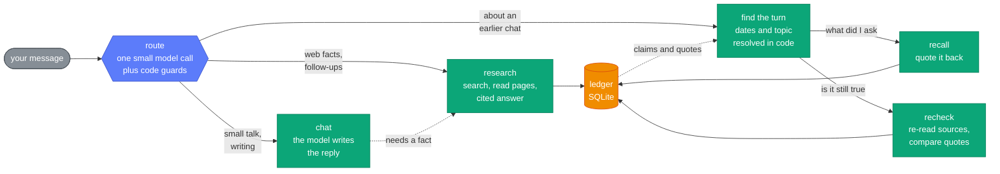

# tracebac

A chat agent whose only tool is web search. It answers with cited sources, remembers what you asked and when, and can re-check its own earlier answers ("has any of that changed since Monday?"). The reasoning behind it is in [DESIGN.md](DESIGN.md).

## Run it

You need Node 22.18 or newer and two free API keys, no credit card: one for a model, one for search.

```bash
npm install
cp .env.example .env
```

(On Windows use `copy .env.example .env`.) Put your keys in `.env`, at least one from each group:

| Group | Pick one or more | Sign up |
|---|---|---|
| Model | Cerebras | https://cloud.cerebras.ai |
| Model | Groq | https://console.groq.com/keys |
| Model | Gemini | https://aistudio.google.com/apikey |
| Model | OpenRouter | https://openrouter.ai/keys |
| Search | Tavily | https://app.tavily.com |
| Search | Exa | https://dashboard.exa.ai |
| Search | Serper | https://serper.dev |

Cerebras plus Tavily is the easiest start. More than one key per group adds fallbacks, which helps on free tiers. If a key is missing, the app stops and tells you which one and where to get it.

```bash
npm run dev
```

Open http://localhost:3000. Your history is saved in `data/tracebac.db`; delete the `data` folder to start clean.

## Try it

- `compare neon and supabase pricing for postgres`
- `last fc barcelona game with score`, then `games before that?`
- `give me funny pickup lines`, then `give me 5 more`

### Questions about earlier days

A fresh install has no history, so "what did I ask on Monday?" has nothing to find. `npm run replay` creates real history at past dates (real searches, real answers):

1. Set `ALLOW_CLOCK_OVERRIDE=true` in `.env` and restart `npm run dev`.
2. In a second terminal run `npm run replay`. It takes about a minute.
3. Open http://localhost:3000/?user=demo and ask what it prints, for example:
   - `On Monday we shortlisted 5 CRM tools for a 20-person sales team. Has any of them changed pricing or shipped something big since?`
   - `What did I ask you on 10 November? Is your answer still correct today?`
   - `Last Tuesday I asked you about Postgres hosting. Has any pricing changed since then?`

## How it works



- **Route.** One small model call picks the route and rewrites a follow-up as a full question ("games before that?" becomes a question about the right team). Code guards fix the costly mistakes: a message about the past never becomes a web search, and a factual question is never answered from the model's memory.
- **Dates are code.** "Monday", "last Tuesday" and "3 November" are resolved against the timezone saved with each turn. The model never does date arithmetic, and a conversation that never happened is never invented.
- **Research.** Searches run in parallel, pages are read, the best excerpts become numbered evidence and the answer cites them. For questions about now it also searches the last 30 days and shows each source's publish date. Afterwards a background step saves the answer as claims, each with the exact quote it came from.
- **Recheck.** The old sources are fetched again. If the saved quote is still on the page the claim is unchanged, proven without a model. The rest go to one batched model call that must quote its evidence. The change report ("1 of 5 changed") is counted and written by code.
- **Memory.** One SQLite file: turns with UTC time and local date, entities, shortlists with time ranges, and claims linked to their sources. No embeddings and no vector database; the questions are about dates, topics and names, which a normal database finds exactly.
- **Free tiers.** Each model role has a fallback chain across the providers you set keys for, with limits tracked per model. If every model is over its limit, the app shows the sources it found instead of a written answer, and the server log says which provider refused.

`src/pipeline.ts` runs a turn; `src/understand.ts` is the router, `src/memory.ts` the ledger, `src/research.ts` and `src/recheck.ts` the two ways of using the web.
